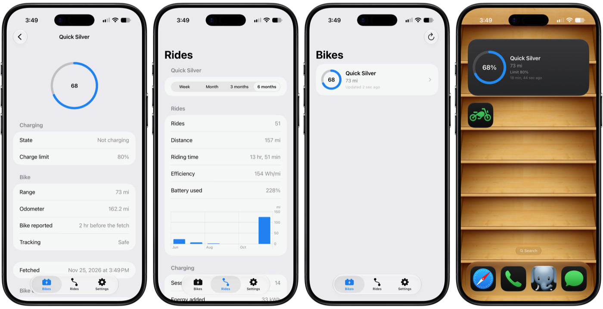

# ios-livewire

An unofficial iOS app and widget that show the **battery level**, **range**, and **ride and charging
totals** of a LiveWire electric motorcycle. It is an example project for a blog post about mapping an
undocumented API.



> **Not affiliated with LiveWire or Harley-Davidson.** It uses an undocumented API that can change or stop
> working at any time. Use it with your own account and your own bike.

> **Built on [py-livewire](https://github.com/hass-livewire/py-livewire).** That Python project mapped
> LiveWire's mobile API from the Android app, and this app re-implements the same calls in Swift. If you
> want a Python client or a Home Assistant integration, start there. Its pairing tool (`livewire pair`)
> was also how this project confirmed that pairing works at all.

## Tested on

A **2024 LiveWire S2 Mulholland**, with an iPhone on iOS 27.2. That is the only bike it has been tried on.
Other LiveWire models, and bikes in other regions, may return different fields or behave differently.
Pull requests that add logs or fixtures from other bikes are welcome (read
[docs/logging.md](docs/logging.md) first, and remove anything personal).

## What it does

* Signs in with your LiveWire account (the password is never stored).
* Pairs this install with your bike, once, at the bike, with a code from the bike's display.
* Shows battery percentage, charging state, charge limit, range and odometer for **each bike on the account**.
* Shows ride and charging totals for the week, month, 3 and 6 months, with bar charts.
* A widget (small, medium and Lock Screen sizes) that refreshes itself. Long-press → *Edit Widget* picks the bike.
* Writes persistent, redacted logs, and shares them as one JSON file with one tap, so the API can be mapped
  from real responses. See [docs/logging.md](docs/logging.md).

## Documentation

| | |
|---|---|
| [docs/api.md](docs/api.md) | The API: sign-in, pairing, every endpoint used, response shapes, what is confirmed. |
| [docs/logging.md](docs/logging.md) | What is logged, what is masked, how to get a log off the phone. |
| [docs/security.md](docs/security.md) | What is stored where, what is sent, known weak points. |

## Layout

The Xcode targets are thin shells. Everything lives in one Swift package, `Packages/LiveWireKit`.

| Target | Role |
|---|---|
| `LWModels` | `Bike`, `ChargingStatus`, and the ride and charging analytics, as plain `Sendable` structs. No dependencies. |
| `LWLogging` | CocoaLumberjack file logging, JSON Lines files on disk, redaction, one-file JSON export. |
| `LWSecureStorage` | Keychain access through [Valet](https://github.com/square/Valet). |
| `LWAPI` | Gigya sign-in, session token, endpoints, error envelope, and the `Decodable` wire types. |
| `LWStore` | Snapshot file shared with the widget through an App Group. |
| `LWServices` | Facade that the app and the widget both use. |
| `LWFeatures` | SwiftUI screens and the observable `AppModel`. |
| `LWWidgets` | WidgetKit widget, intent and timeline provider. |

`ios-livewire/IOSLivewireApp.swift` and `LiveWireWidget/LiveWireWidgetBundle.swift` are the only app code.

## Setup

1. Open `ios-livewire.xcodeproj` and pick your signing team for both targets.
2. Bundle IDs and the App Group come from two project-level build settings, `LW_BUNDLE_PREFIX` and
   `LW_APP_GROUP`. **Change the prefix to one you own**: the App Group ID has to be unique across Apple's
   systems, and registering it and sharing the Keychain needs a real signing team.
3. Run on a real iPhone, sign in, then tap your bike and pair it. The Gigya API key LiveWire's own apps use
   is built in (`APIConfiguration.defaultGigyaAPIKey`).
4. **Pairing** needs you at the bike with the ignition on, not in propulsion mode and not charging. The
   backend waits about a minute for the bike. If it reports that the bike did not respond, see
   [docs/api.md](docs/api.md#device-uuid-and-pairing-confirmed).
5. To send logs, tap the share button. It is on the sign-in screen and under Settings → Share logs.

## Tests

The package is iOS-only:

```sh
cd Packages/LiveWireKit
xcodebuild test -scheme LiveWireKit-Package -destination 'platform=iOS Simulator,name=iPhone 17'
```

Tests run against a mock transport with invented fixtures. No account or network is needed.

## How the widget refreshes

WidgetKit gives each widget a limited daily budget and decides when a refresh runs. The widget asks
to reload every 15 minutes while charging and every 30 minutes otherwise, and the app reloads it whenever
it refreshes. If a fetch fails, it shows the last reading marked as offline. Truly live updates would
need push-triggered widget reloads and a server, which this project does not have.

## Privacy

The password is never stored. The Gigya UID, session token and device UUID are in the Keychain. Logs are
redacted (credentials, the VIN and GPS fields), but redaction works by key name, so read a log before you
publish it. Nothing is sent anywhere except to LiveWire's two hosts. Details: [docs/security.md](docs/security.md).

## Credits

* [py-livewire](https://github.com/hass-livewire/py-livewire) (Apache-2.0) documents the endpoints,
  headers and error codes this project uses. This project re-implements the calls in Swift and does not
  copy its source.
* [CocoaLumberjack](https://github.com/CocoaLumberjack/CocoaLumberjack) and
  [Valet](https://github.com/square/Valet).
